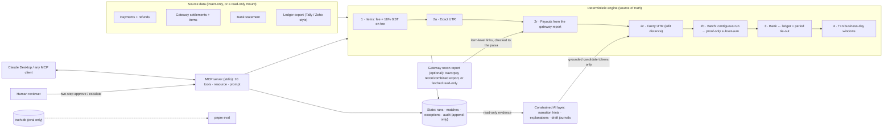

# CloseLoop

**MCP-native month-end reconciliation for Indian finance teams: gateway settlements ↔ bank statement ↔ ledger, with deterministic matching you can audit and an AI layer that is only allowed to read.**

## Results

<!-- results:start (generated by pnpm eval; do not edit) -->
- **Held-out** (8 seeds × 25,000 payments, unseen noise variants included): 90.5% of bank credits linked to exactly the right settlements (n=1467), 1 wrong link; corrupted UTRs recovered 100.0% (n=352), counting correct suggestions a human still confirms.
- **Batch credits:** 76.2% decomposed correctly (contiguous 100.0%, non-contiguous 50.0%), 23.8% sent to a human as ambiguous; missing bank credits 3 detected / 16 deferred / 0 missed.
- **Exceptions:** macro recall 91.8%, precision 94.1% across 13 types; 1,18,947 records/s; full eval 9.5 s. Details in [EVAL.md](EVAL.md).
<!-- results:end -->

## Why this exists

Month-end close at an Indian business that takes payments online comes down to one question: did every rupee a customer paid reach the bank, and is it in the books? Answering it means matching three records that were never designed to agree:

- **The gateway** settles captured payments T+1 or T+2 depending on the method. It deducts its fee and 18% GST on that fee, and nets refunds against the same settlement.
- **The bank statement** often shows one credit for many settlements paid out together. Its narration may carry a UTR that is truncated, split across tokens or reformatted.
- **The ledger** (Tally or Zoho style) has receipts booked by hand, sometimes with a wrong or missing reference, sometimes twice.

Most of this gets done in spreadsheets. Exact matches are easy. The rest is where the days go: a single credit that hides fifteen settlements, a UTR with one wrong character, a payment still inside its settlement window that looks missing but isn't.

An LLM can read a messy narration, but it shouldn't be the one deciding that ₹12,33,701.15 is made up of exactly these fifteen settlements. CloseLoop splits the work:

- **Deterministic code** does every match, sum and verdict. It matches a batch credit only when exactly one run of consecutive settlements, or failing that exactly one set out of all of them, adds up to it. When the amounts allow more than one answer, it says so and hands the decision to a person.
- **The AI layer** only reads evidence: it explains exceptions and drafts journal entries, and every claim must cite records the engine produced. It can't change data, and the system works fully without it.

It runs as an MCP server, so a finance team can ask "what's unreconciled in October, and why?" in Claude and get an answer whose numbers come from code they can audit.

## Architecture



## Try it in 60 seconds

Requires **Node 22.13+** (22 LTS or 24). SQLite is Node's built-in `node:sqlite`, so there are no native modules and nothing is compiled on install.

```bash
npx -y closeloop-mcp check   # seeds a demo dataset, reconciles it, prints the summary
```

From a clone: `pnpm install && pnpm build && npx closeloop-mcp check`.

Add it to Claude Desktop (`~/Library/Application Support/Claude/claude_desktop_config.json`), then restart Claude Desktop:

```json
{
  "mcpServers": {
    "closeloop": { "command": "npx", "args": ["-y", "closeloop-mcp"] }
  }
}
```

From a clone, use absolute paths instead. Claude Desktop doesn't inherit your shell's `PATH`:

```json
{ "mcpServers": { "closeloop": { "command": "/opt/homebrew/bin/node", "args": ["/absolute/path/to/closeloop/packages/mcp/dist/closeloop-mcp.js"] } } }
```

Then ask:
- "What's unreconciled in October and why?"
- "Break down the largest unmatched bank credit."
- "Break down bank credit bnk_000080."
- Or pick the **month_end_review** prompt. [DEMO.md](DEMO.md) lists three demo cases from the October data (a 15-settlement contiguous payout, a corrupted-UTR fuzzy match and a match conflict), picked by code from an actual run.

## Dashboard

**Live: https://closeloop-ivory.vercel.app**: a read-only snapshot of the October demo run.

[`apps/dashboard`](apps/dashboard) is a read-only static site built from one recorded snapshot of the October demo run (`pnpm snapshot`). It shows:
- the month-end summary;
- the exception queue;
- exception detail with evidence, rule trace, source-labelled explanations, draft journals and audit history;
- the batch decomposition visual;
- how it works.

It has no database, no API routes, no LLM calls at runtime and no secrets. Deployment steps for Vercel are in [apps/dashboard/README.md](apps/dashboard/README.md).

## Design principles

**Keep financial truth deterministic; use AI only where data is messy, and only from read-only evidence.**

| Deterministic engine decides | AI layer may |
|---|---|
| every match, exception, exposure class and tie-out | suggest UTR tokens that literally appear in a narration (the scorer still decides) |
| fee/GST arithmetic, in integer paise only | explain an exception from a read-only evidence bundle, citing only ids in that bundle |
| when a batch decomposition is provably unique | propose a journal entry that must balance to the engine's amount (draft, `pending_approval`) |

- **Money is integer paise.** It is validated by zod and stored in SQLite `STRICT` integer columns. Rupee strings are formatted for display only.
- **Financial tables are insert-only.** Database triggers enforce this, and in customer deployments the source data is attached read-only. No tool, model or human action can edit a payment, settlement, bank line or ledger entry.
- **Proof before auto-match.** A batch credit auto-matches only when the subset is proven unique (meet-in-the-middle, or budgeted branch-and-bound), or when it is a unique contiguous run under a stated payout-model assumption. Everything else goes to a human with ranked candidate sets.
- **Humans confirm explicitly.** Approve and escalate are two-step: a preview with a 5-minute single-use token, then token + reviewer name. Every run, investigation, draft, approval and escalation lands in an append-only audit trail with the actor (system / llm / human).
- **Untrusted text stays data.** Narrations and ledger text reach a model only inside `<untrusted_data>` delimiters. The real guards are schema validation, evidence-id checks, a review-policy floor the model can't lower, and the rule that AI output can never create a match.
- **Honest evaluation.** Ground truth lives in a separate database the matcher never receives. Held-out data includes noise variants the rules weren't written around. Noise rates are realistic and never inflated. Every published number is generated.

## Evaluation

`pnpm eval` generates 8 independent datasets (seeds fixed up front in `config/generator.json`). It reconciles the dev and held-out splits of each on isolated in-memory databases, scores them against ground truth, and writes [EVAL.md](EVAL.md) and the Results block above. EVAL.md reports:
- match rate by kind
- precision/recall per exception type, with n and the per-seed spread
- batch results by contiguity and by daily volume
- fuzzy recovery by mechanism
- missing credits as detected / deferred-to-human / missed
- exposure by class
- throughput
- categorised held-out misses
- held-out reconciled twice on identical data, amount-only and with a synthetic gateway recon report, scored from truth links only

CI runs a 5k-payment smoke version on every push.

## MCP server

| Tool | What it does | Annotations |
|---|---|---|
| `run_reconciliation({from?, to?})` | Matched counts by kind, exceptions by type, exposure per class (never summed), bank-vs-books tie-out | writes a run |
| `list_exceptions({type?, exposure_class?, min_amount_paise?, status?, limit?, cursor?})` | Largest first, 20 per page with a cursor, totals for the whole filtered set | read-only |
| `get_evidence({exception_id})` | Records, rule trace, candidate sets with totals, audit history | read-only |
| `explain_exception({exception_id})` | Root cause and recommended action from read-only evidence (LLM or deterministic) | writes audit |
| `decompose_bank_credit({bank_line_id})` | The settlement set behind one bank credit, or the ranked candidate sets | read-only |
| `draft_journal_entry({exception_id})` | Balanced correcting entry, `pending_approval`, never posted | writes draft |
| `approve_suggestion({id, candidate_index?, set_index?, confirm_token?, reviewer?})` | Two-step human approval: preview + token (5 min), then token + reviewer | destructive |
| `escalate({id, note?, confirm_token?, reviewer?})` | Two-step human escalation with a note | destructive |
| `get_audit_trail({entity_id?, limit?, cursor?})` | Append-only audit events, paginated | read-only |
| `import_razorpay_recon({file_path?} \| {from, to})` | Load Razorpay's settlement recon report from a JSON/CSV export, or fetch it read-only from the API | writes gateway report rows (insert-only) |

Also: resource `closeloop://summary/latest` and prompt `month_end_review({month?})`. Every amount comes as raw `amount_paise` plus a pre-formatted `amount_inr` (₹12,33,701.15), and every response starts with a one-line summary, so the model never does arithmetic. On first run with an empty database the server seeds the reproducible demo dataset into `~/.closeloop/closeloop.db` (override with `CLOSELOOP_DB`). Subcommands: `closeloop-mcp check` (one reconciliation, summary to stderr) `closeloop-mcp seed PATH` (write the demo data as a standalone source DB) and `closeloop-mcp demo-report PATH` (write a synthetic Razorpay recon report for the demo data, `.json` or `.csv`).

**MCP Inspector:**

```bash
npx @modelcontextprotocol/inspector node packages/mcp/dist/closeloop-mcp.js      # web UI
npx @modelcontextprotocol/inspector --cli node packages/mcp/dist/closeloop-mcp.js \
  --method tools/call --tool-name decompose_bank_credit --tool-arg bank_line_id=bnk_000080
```

## Using with Razorpay's official MCP server

[Razorpay's MCP server](https://github.com/razorpay/razorpay-mcp-server) gives Claude access to a merchant's Razorpay account: payments, orders, refunds and settlements, including the settlement recon report (`fetch_settlement_recon_details`). CloseLoop does something different with that data: it reconciles settlements against the bank statement and the books. The two run side by side in Claude Desktop:

```json
{
  "mcpServers": {
    "razorpay": {
      "command": "docker",
      "args": ["run", "--rm", "-i", "-e", "RAZORPAY_KEY_ID", "-e", "RAZORPAY_KEY_SECRET", "-e", "READ_ONLY", "razorpay/mcp"],
      "env": { "RAZORPAY_KEY_ID": "rzp_live_…", "RAZORPAY_KEY_SECRET": "…", "READ_ONLY": "true" }
    },
    "closeloop": {
      "command": "npx",
      "args": ["-y", "closeloop-mcp"],
      "env": { "CLOSELOOP_RAZORPAY_KEY_ID": "rzp_live_…", "CLOSELOOP_RAZORPAY_KEY_SECRET": "…" }
    }
  }
}
```

The Razorpay block follows its README (Docker image; `READ_ONLY` is its read-only mode). Razorpay also hosts a remote server at `https://mcp.razorpay.com/mcp`; see its README for that setup.

**Who does what.** Use Razorpay's server to look things up: a payment's status, a refund, one settlement's details. Use CloseLoop to close the month: `import_razorpay_recon` loads the recon report, and `run_reconciliation` then matches each batched bank credit from the report's item-level rows (`BATCH_FROM_GATEWAY_REPORT`) instead of guessing from amounts. A typical session: *"Import Razorpay's settlement recon for October, reconcile October, and tell me what's still open"*, then *"Look up settlement setl_… in Razorpay"* for anything that needs the gateway's side.

**Getting the report into CloseLoop.** Don't route thousands of recon rows through the chat. CloseLoop takes the report directly, in one of two ways:
- **Read-only API fetch:** give CloseLoop its own keys (`CLOSELOOP_RAZORPAY_KEY_ID`, `CLOSELOOP_RAZORPAY_KEY_SECRET`), then call `import_razorpay_recon({from, to})`. The variable names differ from Razorpay's own server so that CloseLoop never picks up keys meant for another process.
- **Export file:** `import_razorpay_recon({file_path})` with JSON in the API's `recon/combined` format, or CSV with the API's field names as headers. Amounts must be integers in paise, as the API returns them: a rupee-denominated column is rejected rather than misread 100×.

**Recon fetching is read-only.** CloseLoop's Razorpay client can only send `GET` to two documented endpoints, `/v1/settlements/recon/combined` and `/v1/settlements`. It has no method that sends a request body or uses another HTTP verb, and a test asserts that every request it makes is a GET. Keys come from the environment only and never appear in tool output or the audit trail. Imported rows go into insert-only tables in CloseLoop's state DB, never into the financial source data, and re-importing the same rows is a no-op.

**Amounts still have to agree.** The report decides *which* settlements a bank credit contains. CloseLoop still checks Σ settlements = Σ report rows (credit − debit) = the bank credit, to the paisa. If the report and the bank disagree, nothing is matched, and a `GATEWAY_REPORT_MISMATCH` exception goes to a human.

**Try it without a Razorpay account.** `npx -y closeloop-mcp demo-report ~/closeloop-recon.synthetic.json` writes a **synthetic** recon report for the demo data in the documented format; every row says so in `notes`. The same report is committed in [fixtures/razorpay/](fixtures/razorpay/) as JSON and CSV. Ask Claude to import it, then reconcile again. On held-out data the eval measures what the report changes (see the Results line above and [EVAL.md](EVAL.md)).

## LLM setup (optional)

CloseLoop works fully with no API key; every AI step has a deterministic fallback. Any OpenAI-compatible chat-completions endpoint works. Put the settings in `.env` (git-ignored), or in `~/.closeloop/.env` for Claude Desktop:

| Provider | `LLM_BASE_URL` | `LLM_MODEL` (example; check the provider's current model list) |
|---|---|---|
| Groq | `https://api.groq.com/openai/v1` | `openai/gpt-oss-120b` |
| Google AI Studio | `https://generativelanguage.googleapis.com/v1beta/openai` | `gemini-2.0-flash` |
| OpenRouter | `https://openrouter.ai/api/v1` | any model id, e.g. `meta-llama/llama-3.3-70b-instruct:free` |

```bash
LLM_BASE_URL=https://api.groq.com/openai/v1
LLM_API_KEY=your-key
LLM_MODEL=openai/gpt-oss-120b
LLM_REASONING_EFFORT=low   # reasoning models only; keeps answers within the token budget
```

Budgets are in `config/ai.json`; narration parsing is sequential and capped per run.

Failure handling:
- An HTTP 429 gets one retry, honouring `Retry-After` and capped at 5 s.
- A second 429, a timeout, a malformed response or a schema failure falls back to the deterministic path. The reason is recorded on the output and in the audit trail.
- JSON mode is requested. If a provider rejects it, CloseLoop retries without it and extracts the JSON from the text.

## Deploying inside a customer environment

The server is built to run next to the data, not the other way round.

```bash
docker compose up                       # demo: seeds ./data/source.db, then starts the server
docker compose run --rm -T closeloop    # attach an MCP client over stdio
```

- **Read-only data mounts.** Point `CLOSELOOP_SOURCE_DB` at the customer's export, mounted `:ro`. CloseLoop attaches it read-only and keeps its own state (runs, exceptions, audit, drafts) in a separate database on a writable volume (`CLOSELOOP_DB`). Writes to source data fail at the storage layer, not just in code. The export must be a SQLite file in rollback-journal mode (not WAL) to be readable from a read-only mount.
- **Hardened container.** Non-root user (uid 10001), read-only root filesystem with a tmpfs `/tmp`, nothing listening on a port. The MCP transport is stdin/stdout.
- **No outbound calls when the LLM and the Razorpay fetch are disabled.** With no `LLM_*` or `CLOSELOOP_RAZORPAY_*` variables the code makes no network requests, and the default compose service runs with `network_mode: none` to guarantee it. The LLM is opt-in through environment variables only (`docker compose --profile llm up closeloop-llm` reads `.env`).
- **Gateway reports inside the network.** With `network_mode: none`, import Razorpay's recon report from an export file mounted read-only. The API fetch needs outbound HTTPS to `api.razorpay.com` only.
- **What leaves when the LLM is on.** Explanation and drafting prompts contain the evidence records, including narrations. To keep data inside the customer's network, point `LLM_BASE_URL` at a self-hosted OpenAI-compatible endpoint (vLLM, Ollama, an internal gateway).
- **Connecting a client** to the containerised server:
  ```json
  { "mcpServers": { "closeloop": { "command": "docker", "args": ["run", "-i", "--rm", "--network", "none", "-v", "/path/to/export:/data:ro", "-v", "closeloop-state:/state", "-e", "CLOSELOOP_SOURCE_DB=/data/source.db", "closeloop-mcp:local"] } } }
  ```

## Lessons from deployment

Running the AI layer against a real free-tier provider (Groq, `openai/gpt-oss-120b`) surfaced problems that mocked tests didn't:

1. **Reasoning models spend the token budget on thinking.** With a 200-token cap the model used every token reasoning and returned an empty answer. Groq then rejected it under JSON mode as `json_validate_failed` (HTTP 400). Fix: send `reasoning_effort: low` when configured, raise the budgets, and classify `json_validate_failed` as a malformed answer rather than a bad request. The deterministic fallback kept every output correct in the meantime, which is the point of having one.
2. **Free-tier rate limits are per minute, and narration parsing ate them.** The tier allowed about 8k tokens a minute (from the response headers). Four parallel narration-parsing calls exhausted it, so the explanations that followed all fell back with `rate_limited`. Fix: narration parsing runs sequentially with a per-run call budget (`config/ai.json`). The one-retry-then-fallback policy means a busy provider degrades output quality, never availability.
3. **LLMs will do arithmetic on paise if you let them.** An early explanation added up raw paise amounts in its prose. Fix: prompts carry pre-formatted `*_inr` strings with an instruction never to compute, and every MCP response includes pre-computed totals, so the client model never has to add anything either.
4. **Model catalogues churn.** The model in the first draft of these docs had been retired. Check the provider's live `GET /models` list before configuring one (that's how `openai/gpt-oss-120b` was chosen); the examples above are only examples.

## Known limitations

- **Synthetic data only.** The generator and the matcher were written by the same person. Held-out noise variants the rules weren't written around reduce, but don't remove, that bias.
- **Narrow scope.** Single currency (INR), one Razorpay-style gateway model, one bank account, no multi-entity books.
- **One gateway connector.** Razorpay's settlement recon report (export or read-only API) is supported. There are no other gateways, no bank-statement parsers and no Tally/Zoho Books sync. Without a report, batch matching falls back to amounts alone, which can't resolve every batch (see EVAL.md).
- **The report is evaluated on synthetic data.** The eval's recon report is generated from the same synthetic data as the bank statement, so it never disagrees with the bank. Disagreement handling is covered by unit tests, not by the eval.
- **The contiguous-batch rule is an assumption.** It holds for hold-and-release and scheduled payouts; when it's wrong, the match is wrong. EVAL.md counts how often.
- **Approximate bank calendar.** The holiday list is illustrative and covers 2026 only.
- **Single node, no authentication.** SQLite on one machine. Reviewer names are self-asserted, and confirmation tokens live in memory, so a restart forgets them.
- **Explanations are checked for structure, not truth.** Schema and cited evidence ids are validated; factual accuracy is not.
- **The dashboard is a static snapshot.** Approvals and escalations happen in the MCP agent, not on the site.

## Development

Requires Node 22.13+ and pnpm (the version is pinned in `packageManager`; `corepack enable` picks it up).

```bash
pnpm install
pnpm typecheck && pnpm lint && pnpm test
pnpm gen --seed 42 --payments 5000      # demo data → ~/.closeloop/closeloop.db (+ truth.db)
pnpm recon --from 2026-10-01 --to 2026-10-31
pnpm eval                               # full eval → EVAL.md (+ README Results)
pnpm eval --payments 5000               # CI smoke
pnpm demo:cases                         # regenerate DEMO.md
pnpm build && pnpm pack:smoke           # bundle, then clean-install test of the npm tarball
```

Repo layout: `packages/core` (generator, matcher, AI layer, audit, eval), `packages/mcp` (server and npm package), `scripts/`, `config/`. The design and every decision are in [PLAN.md](PLAN.md); project conventions are in [CLAUDE.md](CLAUDE.md).

## Credits

Design principle of deterministic truth with constrained AI inspired by RazorRecon (https://github.com/Ragh234/RazorRecon). CloseLoop is an independent implementation focused on batch decomposition, fuzzy matching and multi-source ledgers.
